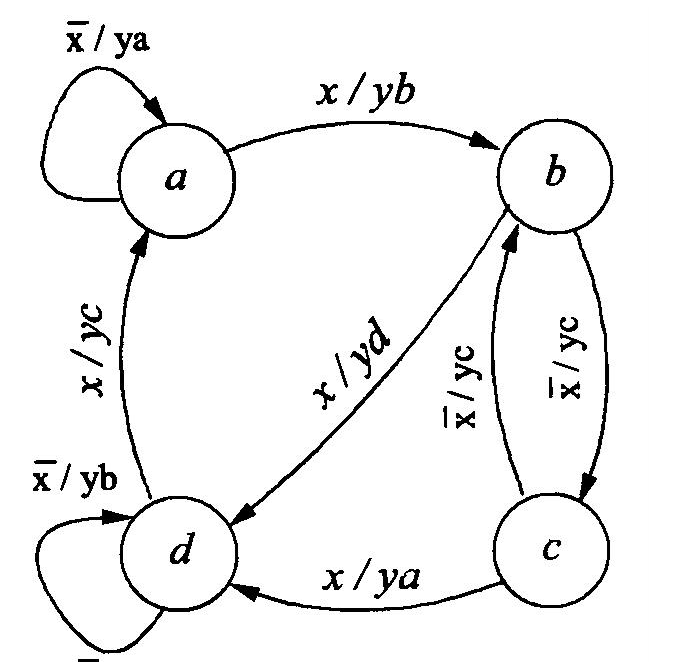
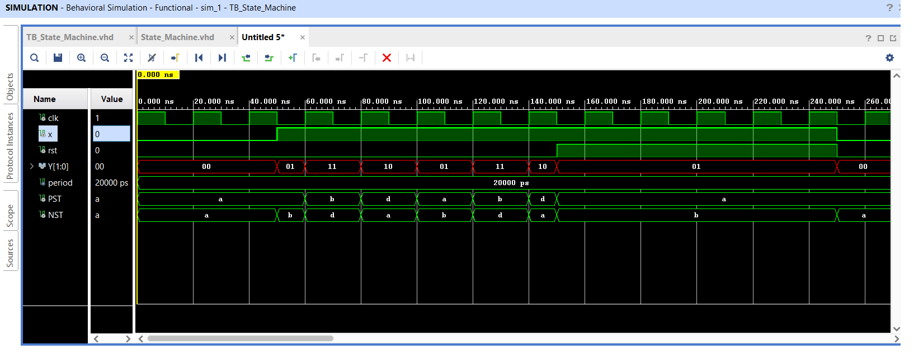
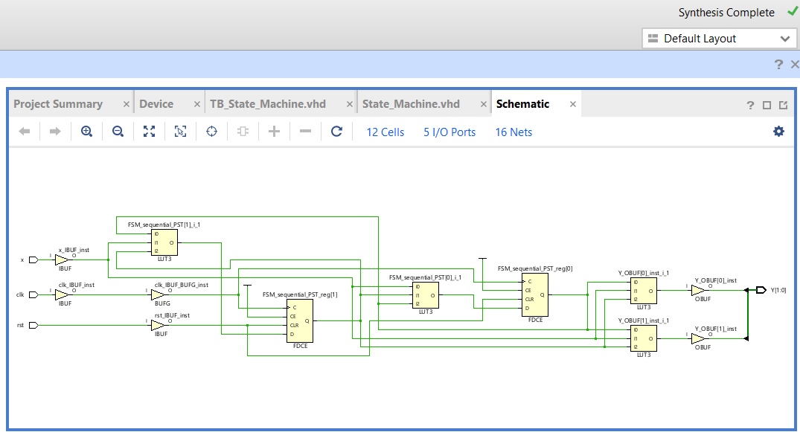

# Mealy Finite State Machine (FSM)

## Overview

This project implements a Mealy finite state machine (FSM) in VHDL based on a given state-transition diagram. The machine contains four states (`a`, `b`, `c`, and `d`) and generates a 2-bit output based on the current state and input.

The design uses separate processes for combinational next-state/output logic and sequential state updating. It includes an asynchronous reset and was simulated and synthesized using Xilinx Vivado.

## State Machine Diagram

The diagram below shows the four states, transition conditions, and associated outputs.

[Open the FSM State Diagram](Images/fsm_state_diagram.png)

## System Specification

The entity `Mealy` has three input ports and one output port.

### Inputs

| Signal | Description                         |
| ------ | ----------------------------------- |
| `x`    | Input controlling state transitions |
| `clk`  | Clock signal                        |
| `rst`  | Asynchronous, active-high reset     |

### Output

| Signal          | Description                                            |
| --------------- | ------------------------------------------------------ |
| `y(1 downto 0)` | 2-bit output determined by the current state and input |

The machine has four states: `a`, `b`, `c`, and `d`. When `rst = '1'`, the present state is reset to the initial state `a`.

## Mealy FSM Operation

A Mealy machine is a type of finite state machine in which the output depends on both the current state and the input. In this implementation, the next-state and output logic is described in a combinational process, while a separate clocked process updates the present state.

### State Transitions and Outputs

The following table summarizes the behavior specified by the state-transition diagram.

| Present State | Input `x` | Next State | Output `y` |
| ------------- | --------: | ---------- | ---------- |
| `a`           |       `0` | `a`        | `00`       |
| `a`           |       `1` | `b`        | `01`       |
| `b`           |       `0` | `c`        | `10`       |
| `b`           |       `1` | `d`        | `11`       |
| `c`           |       `0` | `b`        | `10`       |
| `c`           |       `1` | `d`        | `00`       |
| `d`           |       `0` | `d`        | `01`       |
| `d`           |       `1` | `a`        | `10`       |

### Combinational Process

The first process is sensitive to the input `x` and present state `pst`. A `case` statement determines the next state `nst` and output `y` according to the current state and input.

This process implements the state-transition behavior shown in the diagram and generates the corresponding 2-bit output.

### Sequential Process

The second process updates the present state `pst` based on the clock and reset signals.

* **Asynchronous reset:** When `rst = '1'`, the present state is set to `a`, independently of the clock.
* **Clocked state update:** On each rising edge of `clk`, the present state is updated to the next state `nst`.

Separating the combinational and sequential logic makes the state transitions easier to organize and verify.

## Simulation Results

The testbench applies clock, reset, and input stimulus to verify the state transitions and corresponding outputs.

[Open the FSM Simulation Image](Images/fsm_simulation.png)

## Synthesis Results

The synthesized circuit generated by Xilinx Vivado is shown below.

[Open the FSM Synthesis Image](Images/fsm_synthesis.png)

## Tools and Concepts

* VHDL
* Mealy finite state machines
* State-transition diagrams
* Combinational next-state and output logic
* Clocked sequential logic
* Asynchronous reset
* Testbench design and simulation
* RTL synthesis using Xilinx Vivado
