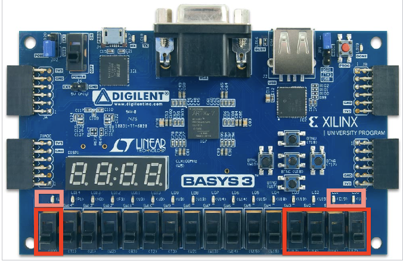

# Basys 3 FPGA – Priority Encoder

## Overview

This project implements a 4-input, 2-bit priority encoder in VHDL and deploys it to a Basys 3 FPGA development board.

The design was developed using Xilinx Vivado and includes VHDL implementation, testbench verification, synthesis, hardware constraints, bitstream generation, and programming of the physical FPGA board.

## Design Specification

The encoder receives a 4-bit input vector `I`, an enable signal `EN`, and produces a 2-bit encoded output `A` and an output-enable signal `OE`.

### Inputs and Outputs

| Signal          | Direction | Description                                                   |
| --------------- | --------- | ------------------------------------------------------------- |
| `I(3 downto 0)` | Input     | Four priority-encoded input signals                           |
| `EN`            | Input     | Enables the encoder                                           |
| `A(1 downto 0)` | Output    | Binary encoding of the highest-priority active input          |
| `OE`            | Output    | Asserted when encoding is enabled and all input bits are zero |

### Priority Encoding Truth Table

The encoder prioritizes inputs in descending order, from `I(3)` to `I(0)`. If multiple input bits are high, the output represents the highest-priority active input.

| EN | I(3) | I(2) | I(1) | I(0) | OE | A(1) | A(0) |
| -: | ---: | ---: | ---: | ---: | -: | ---: | ---: |
|  0 |    X |    X |    X |    X |  0 |    0 |    0 |
|  1 |    1 |    X |    X |    X |  0 |    1 |    1 |
|  1 |    0 |    1 |    X |    X |  0 |    1 |    0 |
|  1 |    0 |    0 |    1 |    X |  0 |    0 |    1 |
|  1 |    0 |    0 |    0 |    1 |  0 |    0 |    0 |
|  1 |    0 |    0 |    0 |    0 |  1 |    0 |    0 |

`X` represents a don't-care input: its value does not affect the result when a higher-priority input has already determined the output.

When `EN = '0'`, the outputs are zero. When `EN = '1'` and all input bits are zero, `OE` is asserted.

## VHDL Implementation

The design is implemented in an entity named `Encoder`, using two processes:

* **Output encoding process:** Determines the 2-bit output `A` based on the enable signal and the priority of the input bits.
* **Output enable process:** Determines `OE`, asserting it when encoding is enabled and all input bits are zero.

The implementation follows the assignment's truth table and does not use `'-'` as a VHDL output value.

## Simulation and Verification

A testbench was used to verify the encoder's behavior in simulation. The assignment requires checking the possible input combinations to confirm that the priority logic and enable behavior operate correctly.

## Synthesis and FPGA Implementation

The design was synthesized using Xilinx Vivado. A bitstream was then generated and programmed onto the Basys 3 FPGA development board.

The board's switches and LEDs were used to interact with and observe the encoder:

* **Enable (`EN`):** Leftmost switch.
* **Input vector (`I`):** Four rightmost switches.
* **Output enable (`OE`):** Leftmost LED.
* **Encoded output (`A`):** Two rightmost LEDs.

The Xilinx Design Constraints (`.xdc`) file maps the top-level design signals to the appropriate physical switches and LEDs on the board.

### Basys 3 Development Board

[Open the Basys 3 Board Photo](Images/basys3_board.png)

## Tools and Concepts

* VHDL
* Priority encoder design
* Combinational logic
* Multiple-process implementation
* Testbench development and simulation
* Xilinx Vivado synthesis
* Xilinx Design Constraints (`.xdc`)
* FPGA bitstream generation and hardware programming
* Basys 3 FPGA development board
